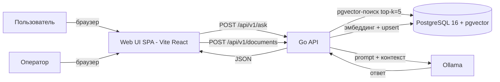

# VulnRAG — спецификация (Spec-Driven Development)

> Статус: **утверждена** (v0.3.0)
> Формат: единый источник истины (single source of truth) для генерации кода и контрактных тестов.
> Сопутствующие артефакты: `api/openapi.yaml`, `features/*.feature`, SQL-миграция (см. разделы 5–7), SPA в `web/` (см. раздел 8).

---

## 1. Цель

RAG-ассистент по открытым источникам об уязвимостях. По текстовому запросу пользователя сервис извлекает сведения об уязвимости из предзагруженного RAG-хранилища; ответ генерирует локальная LLM.



## 2. Акторы

- **user** — единственный тип пользователя, без аутентификации. Работает через веб-форму и напрямую через REST API.
- **operator** — тот же единственный пользователь, загружающий документы в хранилище (разделения ролей нет).

## 3. Функциональные требования

| ID | Требование |
|---|---|
| FR-1 | Пользователь задаёт вопрос об уязвимости → сервис возвращает ответ и список источников, на основе которых ответ сгенерирован. |
| FR-2 | Оператор загружает документ (`title` + `content`) → документ разбивается на чанки, эмбеддинги складываются в pgvector, возвращается `document_id`. Индексация синхронная. |
| FR-3 | Сервис отдаёт статус живости по `GET /health`. |
| FR-4 | Пользователь вводит вопрос в веб-форме «Запрос» → SPA вызывает `POST /api/v1/ask` и отображает ответ с источниками. |
| FR-5 | Оператор заполняет `title` и `content` в веб-форме «Сохранение документа» → SPA вызывает `POST /api/v1/documents` и отображает `document_id` и статус индексации. |

## 4. Доменные правила

- Ответ `/ask` содержит **не более 5 источников** (`top_k = 5`).
- Таймаут генерации ответа — **60 секунд** (иначе `504`).
- Максимальный размер `content` документа — **1 МБ** (иначе `413`).
- `question` обязателен, длина 1..4000 символов.
- `title` обязателен, длина 1..500 символов.
- Ответ приходит **целиком** (без стриминга), источники — в том же ответе.

## 5. Контракт API — OpenAPI 3.1

Файл: [`api/openapi.yaml`](../api/openapi.yaml) (вынесен отдельно на этапе генерации кода).

```yaml
openapi: 3.1.0
info:
  title: VulnRAG API
  version: 0.1.0
  description: RAG-ассистент по открытым источникам об уязвимостях
servers:
  - url: http://localhost:8080
paths:
  /health:
    get:
      summary: Проверка живости сервиса
      responses:
        '200':
          description: OK
          content:
            application/json:
              schema:
                type: object
                properties:
                  status: { type: string, example: ok }
  /api/v1/ask:
    post:
      summary: Задать вопрос об уязвимости
      requestBody:
        required: true
        content:
          application/json:
            schema: { $ref: '#/components/schemas/AskRequest' }
      responses:
        '200':
          description: Ответ ассистента с источниками
          content:
            application/json:
              schema: { $ref: '#/components/schemas/AskResponse' }
        '422':
          description: Пустой или слишком длинный вопрос
          content:
            application/json:
              schema: { $ref: '#/components/schemas/Error' }
        '504':
          description: Таймаут генерации (60 с)
          content:
            application/json:
              schema: { $ref: '#/components/schemas/Error' }
  /api/v1/documents:
    post:
      summary: Загрузить документ в RAG-хранилище
      requestBody:
        required: true
        content:
          application/json:
            schema: { $ref: '#/components/schemas/DocumentRequest' }
      responses:
        '200':
          description: Документ принят и проиндексирован
          content:
            application/json:
              schema: { $ref: '#/components/schemas/DocumentResponse' }
        '413':
          description: content превышает 1 МБ
          content:
            application/json:
              schema: { $ref: '#/components/schemas/Error' }
        '422':
          description: Некорректный payload
          content:
            application/json:
              schema: { $ref: '#/components/schemas/Error' }
components:
  schemas:
    AskRequest:
      type: object
      required: [question]
      properties:
        question:
          type: string
          minLength: 1
          maxLength: 4000
    Source:
      type: object
      properties:
        title:   { type: string }
        url:     { type: string, nullable: true }
        snippet: { type: string }
    AskResponse:
      type: object
      required: [answer, sources]
      properties:
        answer:
          type: string
        sources:
          type: array
          maxItems: 5
          items: { $ref: '#/components/schemas/Source' }
    DocumentRequest:
      type: object
      required: [title, content]
      properties:
        title:
          type: string
          minLength: 1
          maxLength: 500
        content:
          type: string
          minLength: 1
          maxLength: 1048576   # 1 МБ
    DocumentResponse:
      type: object
      required: [document_id, indexed]
      properties:
        document_id: { type: string, format: uuid }
        indexed:     { type: boolean, const: true }
    Error:
      type: object
      required: [error]
      properties:
        error:
          type: object
          properties:
            type:   { type: string }
            detail: { type: string }
```

> Примечание по CORS: SPA обращается к API через тот же origin — в dev через прокси Vite (`/api` → `localhost:8080`), в prod через nginx (`/api` → `app:8080`). Отдельная настройка CORS не требуется; при раздаче SPA с другого origin API должен разрешать CORS для origin приложения.

## 6. Поведение — Gherkin (BDD)

Файлы: [`features/ask.feature`](../features/ask.feature), [`features/documents.feature`](../features/documents.feature) (вынесены отдельно на этапе генерации кода). Исполняются через `godog`.

### features/ask.feature

```gherkin
@ask @regression
Feature: Вопрос-ответ по уязвимостям

  Scenario: Успешный ответ с источниками
    Given в хранилище загружен документ про CVE-2021-44228
    When я отправляю POST /api/v1/ask с вопросом "что такое Log4Shell?"
    Then ответ имеет статус 200
    And в answer есть текст о Log4Shell
    And sources содержит от 1 до 5 источников
    And каждый источник имеет title и snippet

  Scenario: Пустой вопрос отклоняется
    When я отправляю POST /api/v1/ask с пустым question
    Then ответ имеет статус 422
    And в теле ошибки есть detail

  Scenario: Таймаут генерации
    Given Ollama отвечает дольше 60 секунд
    When я отправляю POST /api/v1/ask с любым вопросом
    Then ответ имеет статус 504
```

### features/documents.feature

```gherkin
@documents @regression
Feature: Загрузка документов в RAG-хранилище

  Scenario: Успешная синхронная индексация
    When я отправляю POST /api/v1/documents
      с title "CVE-2021-44228" и content "Log4Shell описание..."
    Then ответ имеет статус 200
    And document_id является UUID
    And indexed равен true
    And документ доступен для поиска через /ask

  Scenario: Слишком большой документ
    When я отправляю POST /api/v1/documents с content размером 2 МБ
    Then ответ имеет статус 413

  Scenario: Пустой title отклоняется
    When я отправляю POST /api/v1/documents с пустым title
    Then ответ имеет статус 422
```

## 7. Модель данных — SQL

Миграция: `migrations/0001_init.sql` (вынесена отдельно на этапе генерации кода).

```sql
CREATE EXTENSION IF NOT EXISTS vector;

CREATE TABLE documents (
    id         UUID PRIMARY KEY DEFAULT gen_random_uuid(),
    title      TEXT NOT NULL,
    content    TEXT NOT NULL CHECK (octet_length(content) <= 1048576),
    created_at TIMESTAMPTZ NOT NULL DEFAULT now()
);

CREATE TABLE chunks (
    id          BIGSERIAL PRIMARY KEY,
    document_id UUID NOT NULL REFERENCES documents(id) ON DELETE CASCADE,
    content     TEXT NOT NULL,
    position    INT  NOT NULL
);

CREATE TABLE embeddings (
    chunk_id   BIGINT PRIMARY KEY REFERENCES chunks(id) ON DELETE CASCADE,
    embedding  vector(768) NOT NULL   -- размерность зависит от модели Ollama
);

CREATE INDEX ON embeddings USING hnsw (embedding vector_cosine_ops);
```

## 8. Веб-интерфейс (Frontend)

Фронтенд — отдельное SPA-приложение в каталоге [`web/`](../web/) (Vite + React + TypeScript). Бэкенд остаётся чистым JSON API; вся клиентская логика выполняется в браузере.

### 8.1 Стек и раздача

- Сборка: **Vite**; язык: **TypeScript**; фреймворк: **React** (без UI-библиотек для MVP).
- Dev: `npm run dev` — dev-сервер Vite на `:5173`; прокси `/api` → `http://localhost:8080` (настройка `server.proxy` в `vite.config.ts`).
- Prod: `npm run build` → статика в `web/dist`; раздаётся контейнером **nginx** в docker compose, nginx проксирует `/api` → `app:8080` (same-origin, CORS не требуется).
- Структура: `web/` (`package.json`, `vite.config.ts`, `src/` — компоненты, сетевой слой, типы).

### 8.2 Страница — две опции

Одна страница с переключением между двумя секциями (вкладки или карточки):

**Опция A — Запрос (Ask)**

- Поле `textarea` для вопроса (1..4000 символов) и кнопка «Запросить».
- Вызов `POST /api/v1/ask` → отображение `answer` и списка источников (`title`, `url`, `snippet`).
- Клиентская валидация дублирует доменные правила: вопрос обязателен, не длиннее 4000 символов.
- Индикатор ожидания (генерация до 60 с); при `422`/`504` показывается `detail` из RFC 7807.

**Опция B — Сохранение документа**

- Поля `title` (1..500 символов) и `content` (`textarea`, ≤1 МБ, со счётчиком размера в байтах) и кнопка «Сохранить».
- Вызов `POST /api/v1/documents` → отображение `document_id` и `indexed: true`.
- Клиентская валидация: `title` и `content` обязательны, `content` ≤ 1 МБ; при `413`/`422` показывается `detail`.

### 8.3 Контракт с бекендом

- Единственный источник контракта — [`api/openapi.yaml`](../api/openapi.yaml); типы `AskRequest`, `AskResponse`, `DocumentRequest`, `DocumentResponse`, `Error` дублируются в TS (вручную либо генерацией через `openapi-typescript`).
- Сетевой слой — `fetch`; базовый URL из `import.meta.env.VITE_API_BASE_URL` (по умолчанию `/` — dev-прокси или nginx).
- Авторизации нет: страница доступна всем, как и API.

### 8.4 Требования к веб-интерфейсу

| ID | Требование |
|---|---|
| FE-1 | Страница содержит обе опции и позволяет переключаться между ними. |
| FE-2 | После успешного `ask` отображаются ответ и источники; после сохранения — `document_id`. |
| FE-3 | Ошибки API отображаются пользователю из `error.detail` (RFC 7807). |
| FE-4 | Клиентские валидации повторяют доменные правила (1..4000, 1..500, ≤1 МБ). |
| FE-5 | Состояние запроса визуализируется: ожидание, успех, ошибка. |
| FE-6 | Интерфейс работает на десктопном браузере (Chrome/Firefox); адаптивность — вне скоупа MVP. |

## 9. Нефункциональные требования

- Язык бэкенда: **Go 1.23+**, маршрутизация — **Echo v4** (`github.com/labstack/echo/v4`).
- БД: **PostgreSQL 16** с расширением **pgvector**.
- LLM и эмбеддинги: **Ollama** (локально; модель эмбеддингов, напр. `nomic-embed-text`).
- Фронтенд: **Node.js 20+**, Vite + React + TypeScript в каталоге `web/`.
- Деплой: **docker compose** (`app` + `postgres` + `ollama` + `web`-nginx, раздающий `web/dist` и проксирующий `/api` → `app:8080`).
- Ошибки API — JSON в формате `{error: {type, detail}}`.
+ Обязательные middleware: Logger, Recover, RequestID, Timeout (60s для `/ask`).
- Генерация каркаса сервера: `oapi-codegen -generate echo-server` по `api/openapi.yaml`.
- Контрактные тесты: `godog` по `features/*.feature`.

## 10. Вне скоупа MVP

- Авторизация / мультитенантность.
- Удаление и обновление документов.
- Стриминг ответа (SSE).
- Асинхронная очередь индексации.
- Расширенный UI: история запросов, стриминг ответа в браузере, редактирование/удаление документов из формы, адаптивность под мобильные.
- E2E-тесты интерфейса (Playwright).

## 11. Открытые вопросы (TODO)

- [x] Выбор фреймворка фронтенда — Vite + React + TypeScript (решено 2026-10-05).
- [ ] Способ генерации TS-типов из `api/openapi.yaml`: вручную vs `openapi-typescript`.
- [ ] Отображение `url` источников в UI (ссылка vs текст), формат сниппета.
- [х] Выбор конкретной модели LLM в Ollama (`llama3.x` vs `qwen` vs др.).
- [ ] Язык ответов (ru/en) — определяется промптом.
- [ ] Формат сниппетов источников (первые N символов чанка).
- [ ] Размерность вектора в `embeddings` (зависит от модели эмбеддингов).

---

## История изменений

| Версия | Дата | Изменение |
|---|---|---|
| 0.1.0 | 2026-10-05 | Первая утверждённая версия по итогам интерактивной SDD-сессии |
| 0.2.0 | 2026-10-05 | Добавлен веб-интерфейс: SPA (Vite + React + TS) с двумя опциями — запрос и сохранение документа; обновлены FR/NFR, диаграмма, границы скоупа и TODO |
| 0.3.0 | 2026-10-09 | Зафиксирована маршрутизация — Echo v4; добавлены обязательные middleware |
